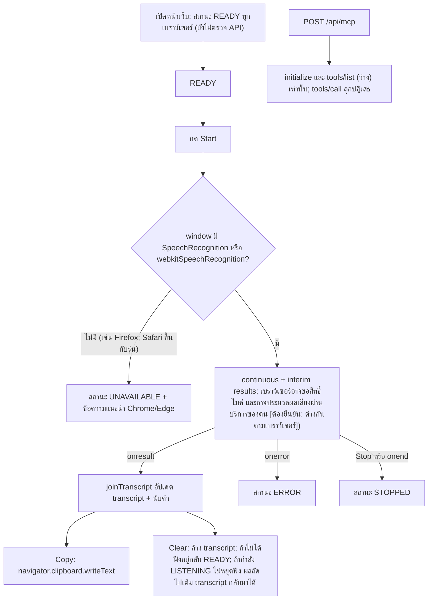

# 01 — Business process (As-Is / To-Be)

ai-speech-to-text-web (Voice Booth) คือหน้าเว็บฝั่ง client ที่ต่อ Web Speech API ของเบราว์เซอร์เข้ากับพื้นที่ transcript สำหรับผู้เยี่ยมชม portfolio บน Chrome/Edge ไม่มี key บริการถอดเสียง หรือ backend ของตัวเอง

Last reviewed: 2026-11-28 · commit `608bb1d`

## As-Is (จากโค้ดวันนี้)

Sources: `app/page.tsx`, `lib/speech.ts`, `app/api/mcp/route.ts`, `PRODUCT.md`

ข้อเท็จจริงจากโค้ด/เอกสาร:

- CI (`ci.yml`) ไม่มีขั้น deploy; deploy แยกต่างหาก: Vercel project `bookchaowalit-speech-to-text-frontend` มี Git link ไป GitHub repo นี้ production branch `main` จึง push เข้า `main` แล้ว deploy ผ่าน Vercel Git (ตรวจผ่าน Vercel API 2026-11-28, ดู G1); production ตอนนี้ = `main` HEAD ef00f09
- ไม่มีการอัด อัปโหลด หรือเก็บเสียง/transcript ที่ server; reload แล้วหาย; เสียงอาจถูกส่งไปบริการ speech ของเบราว์เซอร์ (เช่น Chrome) ซึ่งเป็นนอกแอป
- Copy วาง transcript ลง clipboard ของระบบ ซึ่งอาจค้างหลัง Clear (`PRODUCT.md` §Known limits)
- `/api/mcp` เป็น JSON-RPC แบบ stateless: error ทุกชนิด (รวม method/tool ไม่รู้จัก) ตอบ HTTP 400 พร้อม code JSON-RPC
- error ฝั่งเว็บและ server ที่ Sentry SDK จับได้ไป Sentry เมื่อมี `NEXT_PUBLIC_SENTRY_DSN` (`lib/sentry.ts`); เหตุการณ์ `onerror` ของตัวถอดเสียงตั้งแค่สถานะ ERROR ไม่ถูกรายงาน; `PRODUCT.md` ว่าตั้งบน Vercel แล้ว [ต้องยืนยัน]

## To-Be

ไม่มี To-Be ที่เขียนไว้

## Gap

| ID | As-Is → To-Be | Status | Owner | Evidence |
|---|---|---|---|---|
| G1 | Vercel Git link ชี้ repo ชื่อเก่า push `main` จึงไม่ deploy (deploy ด้วย CLI เท่านั้น) → owner เชื่อม Vercel Git กับ repo นี้ | done | owner | `PRODUCT.md` §Live URL and deploy state (owner action D9); Vercel API 2026-11-28: project `bookchaowalit-speech-to-text-frontend` Git link → `bookchaowalit-website/ai-speech-to-text-web`, production branch `main` |
| G2 | ไม่มี To-Be ของกระบวนการ → owner กำหนด (หรือยืนยันว่าแอปนี้คงขอบเขตปัจจุบัน) | decide | owner | ไม่มีใน `PRODUCT.md` / `docs/` |

## Open questions

- production = `main` HEAD ef00f09 (ตรวจ 2026-11-28) จึง deploy L2 (tests, Sentry, MCP ตรงความจริง) แล้ว; ค่า env บน production เช่น `NEXT_PUBLIC_SENTRY_DSN` [ต้องยืนยัน]
