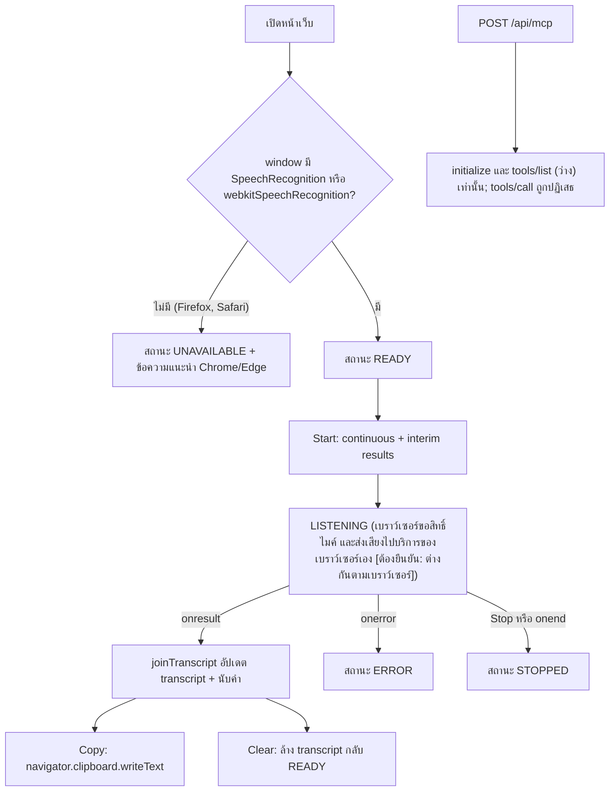

# 01 — Business process (As-Is / To-Be)

ai-speech-to-text-web (Voice Booth) คือหน้าเว็บฝั่ง client ที่ต่อ Web Speech API ของเบราว์เซอร์เข้ากับพื้นที่ transcript สำหรับผู้เยี่ยมชม portfolio บน Chrome/Edge ไม่มี key บริการถอดเสียง หรือ backend ของตัวเอง

Last reviewed: 2026-11-28 · commit `608bb1d`

## As-Is (จากโค้ดวันนี้)

Sources: `app/page.tsx`, `lib/speech.ts`, `app/api/mcp/route.ts`, `PRODUCT.md`

ข้อเท็จจริงจากโค้ด/เอกสาร:

- ไม่มีการอัด อัปโหลด หรือเก็บเสียง/transcript ที่ server; reload แล้วหาย; เสียงอาจถูกส่งไปบริการ speech ของเบราว์เซอร์ (เช่น Chrome) ซึ่งเป็นนอกแอป
- Copy วาง transcript ลง clipboard ของระบบ ซึ่งอาจค้างหลัง Clear (`PRODUCT.md` §Known limits)
- `/api/mcp` เป็น JSON-RPC แบบ stateless: error ทุกชนิด (รวม method/tool ไม่รู้จัก) ตอบ HTTP 400 พร้อม code JSON-RPC
- error ฝั่งเว็บและ server ไป Sentry เมื่อมี `NEXT_PUBLIC_SENTRY_DSN` (`lib/sentry.ts`); `PRODUCT.md` ว่าตั้งบน Vercel แล้ว แต่ใช้ได้เมื่อ deploy ครั้งถัดไป [ต้องยืนยัน]

## To-Be

ไม่มี To-Be ที่เขียนไว้

## Gap

| ID | As-Is → To-Be | Status | Owner | Evidence |
|---|---|---|---|---|
| G1 | Vercel Git link ชี้ repo ชื่อเก่า push `main` จึงไม่ deploy (deploy ด้วย CLI เท่านั้น) → owner เชื่อม Vercel Git กับ repo นี้ | todo | owner | `PRODUCT.md` §Live URL and deploy state (owner action D9) |
| G2 | ไม่มี To-Be ของกระบวนการ → owner กำหนด (หรือยืนยันว่าแอปนี้คงขอบเขตปัจจุบัน) | decide | owner | ไม่มีใน `PRODUCT.md` / `docs/` |

## Open questions

- ตั้งค่า production ตาม `PRODUCT.md` ยังไม่ได้ deploy L2 (tests, Sentry, MCP ตรงความจริง) [ต้องยืนยัน]
